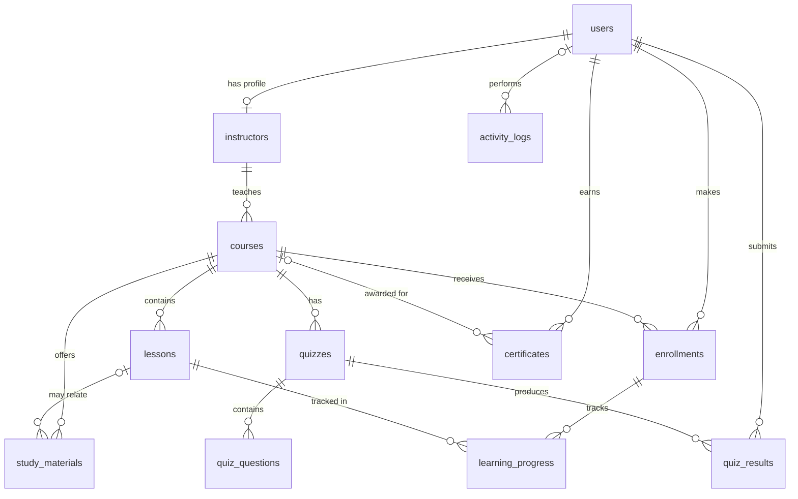

# Database schema

The single source of truth is [`database/schema.sql`](../database/schema.sql) (PostgreSQL). The
backend applies it at start-up; for SQLite only the auto-increment key syntax is translated.

## Entity relationship diagram

(View in a Markdown preview that supports Mermaid, such as GitHub.)

## Tables

PK = primary key, FK = foreign key. Booleans are stored as 0 / 1. Timestamps are ISO-8601 UTC text.

### users
| Column | Type | Notes |
|---|---|---|
| id | serial | PK |
| name | varchar(100) | required |
| email | varchar(254) | unique, lower case |
| password_hash | text | salted hash; the password is never stored |
| role | varchar(20) | `student`, `instructor`, `admin` |
| is_active | integer | deactivated users cannot sign in |
| token_version | integer | raising it signs out all sessions |
| created_at, last_login_at | text | |

### instructors
| Column | Type | Notes |
|---|---|---|
| user_id | integer | PK, FK users (cascade) |
| headline, bio, expertise | text | public profile |
| is_approved | integer | set by an admin |
| created_at | text | |

### courses
| Column | Type | Notes |
|---|---|---|
| id | serial | PK |
| instructor_id | integer | FK instructors (restrict) |
| title, summary, description | text | |
| category | varchar(60) | list in `backend/app/config.py` |
| level | varchar(20) | Beginner, Intermediate, Advanced |
| thumbnail_key | text | storage key of the cover |
| status | varchar(20) | `draft` or `published` |
| is_featured | integer | shown on the home page |
| created_at, updated_at | text | |

### lessons
| Column | Type | Notes |
|---|---|---|
| id | serial | PK |
| course_id | integer | FK courses (cascade) |
| title, content | text | content holds the notes |
| video_type | varchar(10) | `none`, `upload`, `youtube`, `url` |
| video_key | text | uploaded file |
| video_url | text | YouTube embed or MP4 link |
| duration_seconds | integer | used for the 90% rule |
| position | integer | order within the course |
| created_at | text | |

### study_materials
| Column | Type | Notes |
|---|---|---|
| id | serial | PK |
| course_id | integer | FK courses (cascade) |
| lesson_id | integer | optional FK lessons (set null) |
| title, file_name, content_type | text | |
| file_key | text | storage key |
| file_size | integer | bytes |
| created_at | text | |

### quizzes
| Column | Type | Notes |
|---|---|---|
| id | serial | PK |
| course_id | integer | FK courses (cascade) |
| title, description | text | |
| pass_percentage | integer | 1 to 100 |
| max_attempts | integer | 0 = unlimited |
| created_at | text | |

### quiz_questions
| Column | Type | Notes |
|---|---|---|
| id | serial | PK |
| quiz_id | integer | FK quizzes (cascade) |
| prompt, explanation | text | |
| options | text | JSON array of 2 to 6 strings |
| correct_index | integer | never sent to students before they may see it |
| position | integer | |

### enrollments
| Column | Type | Notes |
|---|---|---|
| id | serial | PK |
| student_id | integer | FK users (cascade) |
| course_id | integer | FK courses (cascade) |
| enrolled_at, last_accessed_at, completed_at | text | |
| | | unique (student_id, course_id) |

### learning_progress
| Column | Type | Notes |
|---|---|---|
| id | serial | PK |
| enrollment_id | integer | FK enrollments (cascade) |
| lesson_id | integer | FK lessons (cascade) |
| watched_seconds, last_position | integer | resume point and watch time |
| is_completed | integer | |
| completed_at, updated_at | text | |
| | | unique (enrollment_id, lesson_id) |

### quiz_results
| Column | Type | Notes |
|---|---|---|
| id | serial | PK |
| quiz_id | integer | FK quizzes (cascade) |
| student_id | integer | FK users (cascade) |
| score, total, percentage, passed | integer | |
| answers | text | JSON snapshot, so reviews survive later quiz edits |
| submitted_at | text | |

### certificates
| Column | Type | Notes |
|---|---|---|
| id | serial | PK |
| code | varchar(40) | unique public ID |
| student_id | integer | FK users (cascade) |
| course_id | integer | FK courses (set null) |
| student_name, course_title, instructor_name | text | snapshot printed on the PDF |
| issued_at | text | |
| | | unique (student_id, course_id) |

### activity_logs
| Column | Type | Notes |
|---|---|---|
| id | serial | PK |
| user_id | integer | FK users (set null) |
| action, details | text | |
| created_at | text | |

## Changing the schema

`CREATE TABLE IF NOT EXISTS` adds new tables but does not alter existing ones. To add a column to
a database that holds data, run an `ALTER TABLE` statement yourself.
